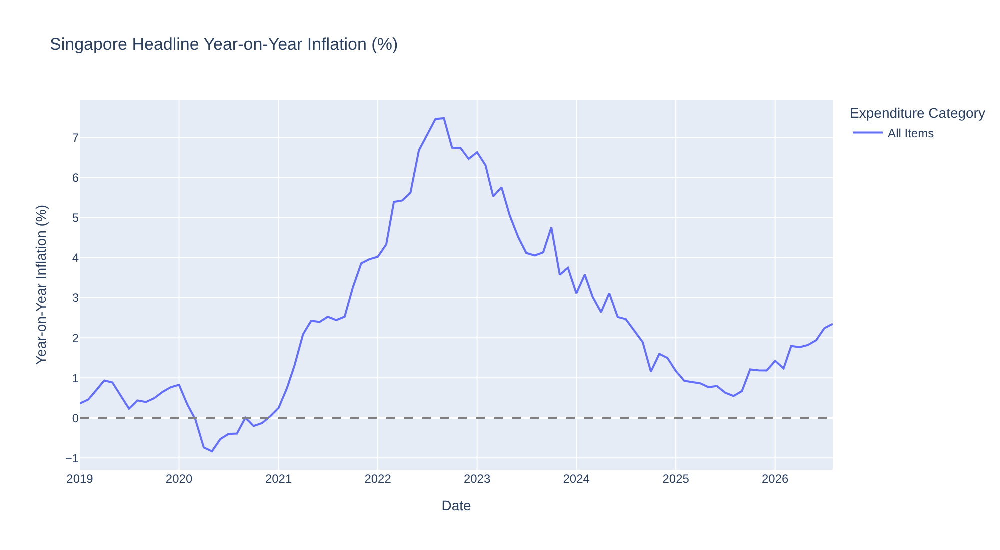
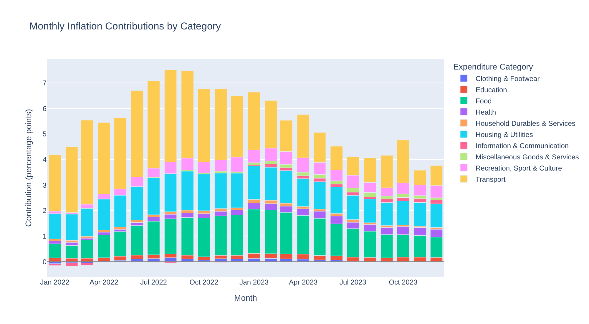
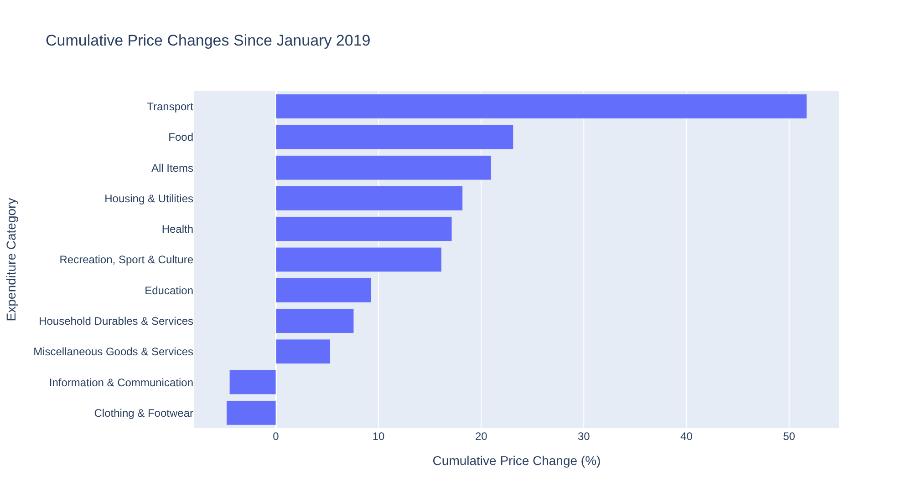
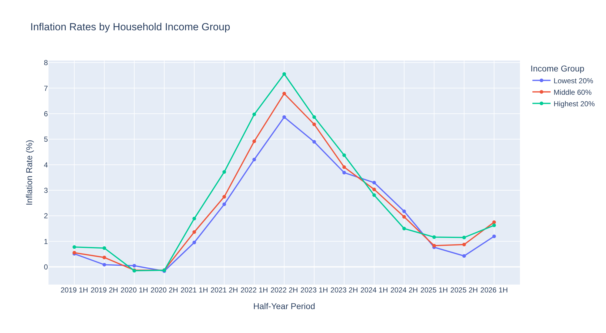
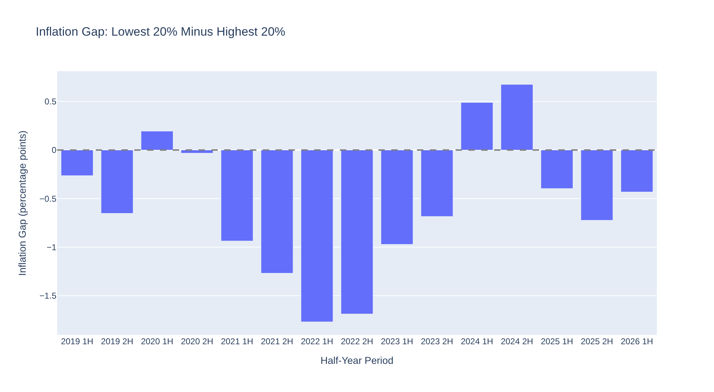
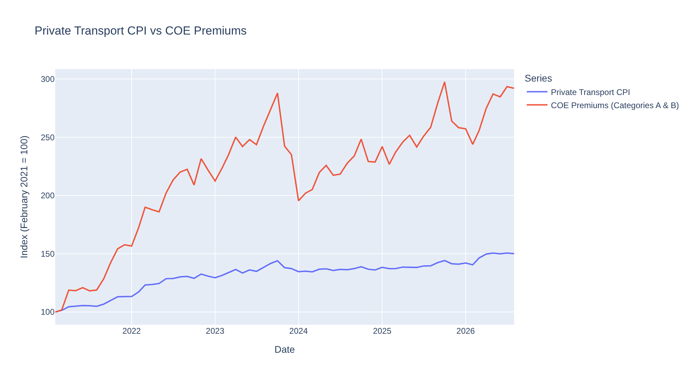

# Who Feels Inflation Most? Singapore CPI by Category and Household Income

**Live dashboard:** https://ds608-sg-inflation.streamlit.app/

**Group members:** Jiang Liu Ru, Amsyar Minhaj, Su Liang-Yu

This project is MDSE group work, completed for DS608 Data Analytics for Economics. See [CONTRIBUTIONS.md](CONTRIBUTIONS.md) for who did what and [AI_USAGE.md](AI_USAGE.md) for how we used generative AI.

## Motivation and objective

Singapore's headline inflation reached 7.49% in September 2022, its highest in over a decade, and then cooled to 2.35% by August 2026. Households still feel that prices are high. A single headline number hides two things: which spending categories pushed prices up, and whether the same price changes hit lower-income households harder than higher-income ones.

**Research question:** Which spending categories have driven Singapore's inflation since 2019, and have lower-, middle- and higher-income households experienced inflation differently?

This is a descriptive study. We show what drove *measured* inflation, not why each price changed.

## Repository structure

```
.
├── README.md                 # Project overview (this file)
├── AI_USAGE.md               # Generative AI usage statement
├── CONTRIBUTIONS.md          # Each member's contributions
├── requirements.txt          # Python dependencies
├── .gitignore
├── app.py                    # Streamlit dashboard: page layout only
├── data/
│   ├── raw/                  # Original downloaded files (unchanged)
│   └── processed/            # Clean, analysis-ready files made by src/wrangle.py
├── src/
│   ├── wrangle.py            # Data cleaning: raw -> processed (one function per dataset)
│   ├── analysis.py           # Analysis: processed -> outputs/tables
│   ├── load_data.py          # Reads the output tables for the dashboard
│   ├── metrics.py            # Small calculations shown in the dashboard
│   ├── plots.py              # One function per dashboard chart (Plotly)
│   └── save_figures.py       # Saves the main charts to outputs/figures
└── outputs/
    ├── tables/               # Analysis results (CSV) and key_findings.md
    ├── figures/              # Charts used in this README
    ├── presentation/         # Final presentation slides (PDF)
    └── dashboard/            # Early notebook used to prototype the dashboard
```

## Setup and how to run

Requires Python 3.10 or later. From the project folder:

```bash
pip install -r requirements.txt

# 1. Clean the raw data -> data/processed/
python src/wrangle.py

# 2. Run the analysis -> outputs/tables/
python src/analysis.py

# 3. Start the dashboard
streamlit run app.py
```

Optional, to regenerate the images in `outputs/figures/` (needs Google Chrome or Chromium installed):

```bash
pip install kaleido
python -m src.save_figures
```

All paths in the code are relative to the project folder, so the steps work on any computer. The processed data and output tables are already committed, so `streamlit run app.py` also works straight after `pip install`.

## Data

All data are public aggregate statistics with no personal information. The raw files are small and published under open licences, so they are included in `data/raw/`. To download them again, use the sources below and save them under the same file names.

| File in data/raw/ | Source | Downloaded | Licence |
| --- | --- | --- | --- |
| cpi_2024base_monthly.csv | CPI, 2024 as Base Year, Monthly, data.gov.sg (SingStat) | 24 Oct 2026 | Singapore Open Data Licence |
| cpi_by_income_group_lowest/middle/highest.csv | CPI by Household Income Group, 2024 as Base Year, Half-Yearly, SingStat Table Builder | 24 Oct 2026 | SingStat terms of use |
| cpi_weights_2024.csv | Typed from Appendix III (pp. 29-36) of SingStat's Rebasing of the CPI (2024 as Base Year) information paper, available on SingStat's "CPI related information and rebasing papers" page | 24 Oct 2026 | SingStat terms of use |
| coe_bidding_results.csv | COE Bidding Results / Prices, LTA, data.gov.sg | 24 Oct 2026 | Singapore Open Data Licence |
| hdb_rents.csv | Renting Out of Flats from Jan 2021, HDB, data.gov.sg | 24 Oct 2026 | Singapore Open Data Licence |

`python src/wrangle.py` reads `data/raw/` and writes 5 files to `data/processed/`:

- `cpi_monthly_long.csv`: one row per CPI series per month (date, series, level, level_name, parent, cpi, yoy_pct, mom_pct)
- `cpi_income_groups_long.csv`: CPI for the lowest 20%, middle 60% and highest 20% of households, half-yearly, with yoy_pct
- `cpi_weights_2024.csv`: each category's weight per 10,000 and % share of spending
- `coe_monthly.csv`: average COE premium per month for each category
- `hdb_rents_monthly.csv`: median HDB rent per month by flat type

`.gitignore` excludes Python caches, virtual environments, `.env` files and Streamlit secrets. No data files are excluded, and the project needs no API keys.

## Analytical approach

1. **Wrangle** (`src/wrangle.py`): reshape the wide SingStat tables into long format (one row per series per month), label each series by its level in the CPI tree (all items, division, group, class), and compute year-on-year and month-on-month inflation.
2. **Decompose** (`src/analysis.py`): split headline year-on-year inflation into the contribution of each of the 10 CPI divisions, in percentage points:

   contribution = weight × (index now − index a year ago) ÷ all-items index a year ago × 100

   We use the 2019 basket weights for 2019–2023 (with the indexes rebased to 2019 = 100 so they match the weights) and the 2024 weights from 2024 onward. We check the method by comparing the sum of the 10 contributions with actual headline inflation (residual check), and by recomputing the rankings with the other set of weights (weight sensitivity).
3. **Compare periods:** rank the divisions by their average contribution in the 2022–23 surge and the 2024–26 cooling.
4. **Compare income groups:** compare half-yearly All Items inflation for the lowest 20%, middle 60% and highest 20% of households, and the percentage-point gap between them, overall and by division.
5. **Behind the numbers:** set the Private Transport CPI against COE premiums, and the Accommodation CPI against HDB median rents, all indexed to February 2021 = 100.

The dashboard (`app.py`) has five tabs that follow these steps: Overview & Category Explorer, What Drove Inflation?, Cumulative Price Changes, Rich vs Poor, and Behind the Numbers.

## Key findings

All figures come from `outputs/tables/` (summary in [key_findings.md](outputs/tables/key_findings.md)).

**1. Inflation surged in 2022 and then cooled.** Headline inflation peaked at 7.49% in September 2022 and was 2.35% in August 2026.



**2. Transport, Food and Housing & Utilities contributed most.** In the peak month (September 2022), Transport contributed 3.43 pp, Housing & Utilities 1.53 pp and Food 1.48 pp. The same three ranked highest in both the 2022–23 surge (Transport first, averaging 2.11 pp) and the 2024–26 cooling (Housing & Utilities first, averaging 0.49 pp). In August 2026 Transport still contributed the most, at 1.07 pp.



**3. Transport prices rose the most since 2019.** From January 2019 to August 2026, the Transport CPI rose 51.7%, Food 23.1% and Housing & Utilities 18.2%.



**4. Lower-income households did not consistently face higher inflation.** The lowest 20% had higher inflation than the highest 20% in only 3 of 15 half-years since 2019 (2020 1H, 2024 1H and 2024 2H). In 2026 1H the gap was −0.43 pp: 1.20% for the lowest 20% against 1.63% for the highest 20%. By division, Education (−2.76 pp) and Health (−2.71 pp) had the largest negative gaps, and Transport (+1.25 pp) had the largest positive gap.





**5. COE premiums and HDB rents rose faster than the matching CPI groups.** Between February 2021 and August 2026, the COE premium index reached 292 while the Private Transport CPI reached 150. HDB median rents reached 160 while the Accommodation CPI reached 115. These are descriptive comparisons and do not show causation.



**Robustness.** The summed contributions were within 0.3 pp of headline inflation in 97.8% of months (largest gap 0.39 pp, October 2024). The top three contributors are the same under 2019 and 2024 weights from April 2026 onward, but differ in some months of 2025 and early 2026.

## Limitations

- CPI measures price *changes* for an average basket, not price levels or any one household's spending.
- The CPI basket changed in 2024, so contribution sizes before and after 2024 are not directly comparable. Across periods we compare rankings and inflation rates, not contribution sizes. 2024 contributions use approximate transitional weights.
- Income-group CPI is only half-yearly, and we did not collect income-group weights. Category gaps are differences in inflation rates, not contributions to the overall income gap.
- The decomposition is an approximation. The residual is largest in 2019 and 2024, when the comparison crosses a basket change.
- COE has no data for Apr–Jun 2020 (bidding was suspended during the circuit breaker).
- HDB rents are declared by owners and not verified by HDB. The 1-room median is based on very few rentals.
- The COE and HDB comparisons are descriptive. Co-movement does not establish causation.
- We did no base-year linking ourselves: the 2024-base series from data.gov.sg is already officially linked back to 1961, so the 2019-base series was not needed.

## Presentation

The final slides are in [outputs/presentation/](outputs/presentation/).
